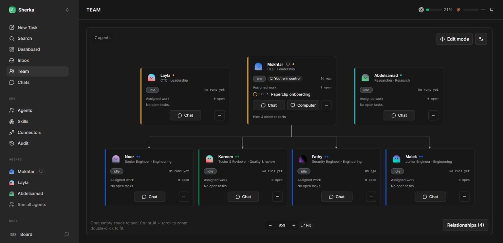
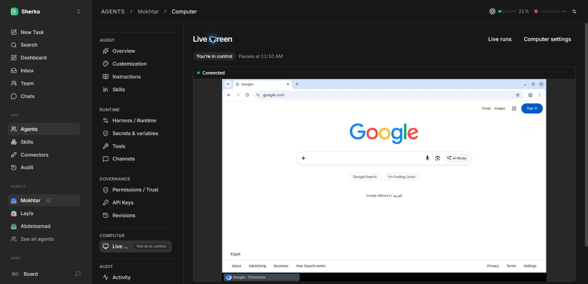
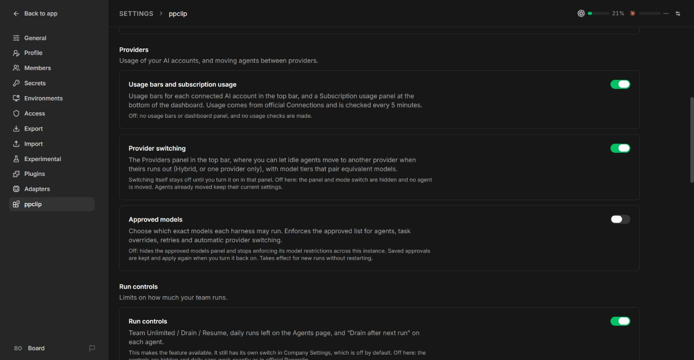
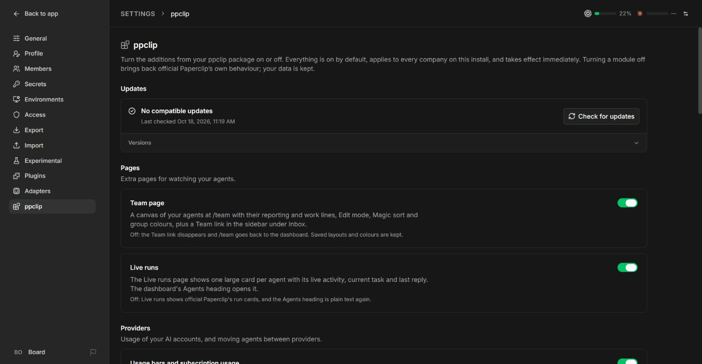

# ppclip

**A modular upgrade for your Paperclip workspace.**

Watch your team, follow live runs, manage AI providers, and give agents a desktop you can take over. ppclip adds features and fixes to an [official Paperclip checkout](https://github.com/paperclipai/paperclip) through a reversible overlay.

You keep the official repository. ppclip adds its own modules and marked integration hooks; the installer can remove the overlay again while keeping your data.

[Install](#quick-start) · [Features](#features) · [Screenshots](#screenshots) · [Updates](#updates-and-removal) · [Documentation](#documentation)

## Features

| Area | What ppclip adds |
|---|---|
| **Team canvas** | Reporting and work relationships, editable layouts, Magic sort, and group colours. |
| **Agent chat** | Chat enabled by default, configured model labels in the sidebar, clearer follow-up runs, and activity scoped to the right task. |
| **Live runs** | One card per agent with live activity, the current task, and the last reply. |
| **Computer use** | A Linux desktop and Chromium per agent, live view, human takeover, private control, and persistent browser profiles. |
| **Providers** | Account usage bars, subscription usage, model tiers, and optional switching between providers. |
| **Approved models** | Company-specific model lists enforced before dispatch, including task overrides and provider switches. Independently switchable. |
| **Run controls** | Team Unlimited / Drain / Resume, daily runs left, and “Drain after next run.” |
| **Agent visibility** | Urgency ordering, attention statuses, pending confirmations, roster columns, and task hover details. |
| **Updates and fixes** | Compact update status and progress, recovery for stale run states, live refresh, and Windows sign-in fixes. |

**Choose what stays on.** Open **Settings → ppclip** to toggle modules independently across the instance. Module availability defaults to on; computer access, automatic provider switching, and run controls require their own opt-in settings. Only instance administrators can change module switches.

Agent chat retains its separate Experimental switch. Approved models defaults to on, requires an explicit approved model for model-based runs, and can be disabled without deleting its saved lists. See [model approvals](docs/model-approvals.md).

## Screenshots

Actual captures from a local installation. Names, usage values, and switch states reflect that installation rather than product defaults. [Capture notes](docs/images/README.md).

### Computer controls

Watch an agent's desktop, take control, pause it, or stop it. The connected desktop below shows the compact status row and control expiry.

<strong>Module settings and updates</strong>

Each module explains what changes when it is disabled. This example has Approved models turned off; its default is on.

### Update settings

Settings → ppclip → Updates shows update status and clear installation progress. Expand **Versions** to see installed and newer Paperclip and ppclip versions and whether a newer Paperclip is waiting for ppclip support.

## Compatibility

The installer requires an **exact supported Paperclip commit** and a clean official checkout for the initial installation.

| Supported Paperclip revision | Official commit | Integration hooks |
|---|---|---|
| Snapshot after `v2026.1017.0-canary.2` | `669d329f2` | [master-669d329f2](hooks/master-669d329f2/) |

Do not apply the overlay to an arbitrary newer Paperclip checkout. The hook manifest records the exact revision it supports.

## Quick start

Requires **Git**, **Node.js 24.11+**, and **pnpm 9.15.4**, plus Paperclip's platform build prerequisites. Docker is only needed for computer use.

Clone the repositories side by side, then apply the overlay:

~~~bash
git clone https://github.com/paperclipai/paperclip
git clone https://github.com/vax1ne0/ppclip
git -C paperclip checkout 669d329f257805ff3c171341ee6942d681cc6a0e

node ppclip/install.mjs install --target ./paperclip --with-deps
~~~

Build Paperclip and start an isolated local instance:

~~~bash
cd paperclip
pnpm build
node scripts/ppclip/start-local.mjs --data ../.ppclip-runtime
~~~

Open **http://127.0.0.1:3410**. Keep the two checkouts and the runtime data folder separate:

~~~text
workspace/
├── paperclip/          Official checkout with the overlay applied
├── ppclip/             This package
└── .ppclip-runtime/    Instance data, configuration, and logs
~~~

The launcher uses ports **3410** for the app, **13410** for its auxiliary listener, and **55440** for embedded Postgres. App and database ports can be changed with `--port` and `--pg-port`. For Windows setup, target discovery, and installer behavior, see [installation](docs/installation.md).

### Add computer use

With Docker running, execute these commands from the **Paperclip checkout**:

~~~bash
node scripts/ppclip/computer-supervisor.mjs build-image
node scripts/ppclip/start-local.mjs --data ../.ppclip-runtime --with-computer
~~~

Enable computer use in Company Settings or the agent's **Configuration → Computer use** card, then give the selected agent a computer. Open its live screen and choose **Start computer**. Supported Claude Code and Codex local agents receive computer tools automatically.

Each browser profile lives in a separate Docker volume. Taking control prevents the agent from acting; private takeover also hides the screen from it. Paused computers stay paused during recovery.

[Computer setup, security, and testing →](docs/computer-use.md)

## Updates and removal

When using the local launcher, open **Settings → ppclip → Updates** to check for a new version and run **Update and restart**. The page tracks progress and reloads when the app returns. Updates require instance-admin access and refuse to overwrite local package changes.

From the parent workspace folder:

~~~bash
node ppclip/install.mjs status --target ./paperclip
node paperclip/scripts/ppclip/update.mjs --check
~~~

To remove the overlay:

~~~bash
node ppclip/install.mjs uninstall --target ./paperclip
~~~

Removal preserves instance data and refuses to discard edited overlay files unless explicitly forced. Back up the runtime folder before updates: ppclip adds no database migrations, but an updated Paperclip version may run its own.

[Update workflow, manual commands, and recovery →](docs/updating.md)

## Data and execution boundaries

- **Settings stay local.** Module flags live in the instance's `ppclip-features.json`. Company policies and computer state use existing activity-log records and agent metadata. Uninstalling leaves this data in place.
- **Computer tools run in Docker.** Desktop containers have memory, CPU, and process limits. They drop all Linux capabilities except SETUID, SETGID, and KILL, used to start services under separate users. Other agent commands follow their configured execution environment.
- **Access is explicit.** Computer use and shell access require separate switches. Supervisor and desktop ports bind to loopback, and live views use short-lived tickets checked against current control state.
- **Guardrails have limits.** Browser navigation filters private and metadata addresses; page content is treated as untrusted. Containers share the host kernel, and these checks do not eliminate prompt injection. See the [computer-use guide](docs/computer-use.md) and [model policy boundaries](docs/model-approvals.md#enforcement).

## Documentation

| Guide | Contents |
|---|---|
| [Installation](docs/installation.md) | Requirements, folder layout, installer behavior, and optional computer setup. |
| [Updates and removal](docs/updating.md) | One-click and manual updates, local edits, logs, rollback, and uninstall. |
| [Computer use](docs/computer-use.md) | Architecture, control states, Docker setup, guardrails, and lifecycle tests. |
| [Approved models](docs/model-approvals.md) | Module switch, company policies, enforcement, exceptions, and storage. |
| [Development](docs/development.md) | Module ownership, testing, export workflow, and porting to another Paperclip revision. |

## Repository layout

~~~text
modules/              ppclip source, grouped into nine modules
hooks/<version>/      Version-specific integration patch and manifest
docs/                 Setup guides and screenshots
tools/                Export utility and real desktop lifecycle smoke test
modules.json          File ownership rules
install.mjs           Install, status, update, and uninstall
~~~

Edit module code in this package or a working installed checkout, then export it back. Each module has its own README. Version-specific edits to official files belong in the hook patch, marked `// ppclip:`.

## License and acknowledgements

Paperclip and ppclip's additions are MIT-licensed. See [LICENSE](LICENSE).

Computer use draws on ideas from [rakazo](https://github.com/elie222/rakazo), [desktop-bridge](https://github.com/connbot/desktop-bridge), [CUA](https://github.com/trycua/cua), [linux-computer-use](https://github.com/Roadmvn/linux-computer-use), [taw-computer](https://github.com/the-agents-work/taw-computer), and [Anthropic's computer-use demo](https://github.com/anthropics/anthropic-quickstarts). See the [research notes](docs/computer-use-research.md).

The Docker image installs Chromium, noVNC, websockify, x11vnc, and other Debian packages under their respective licenses. Those dependencies are installed when building the image; their binaries are not bundled in this repository.
